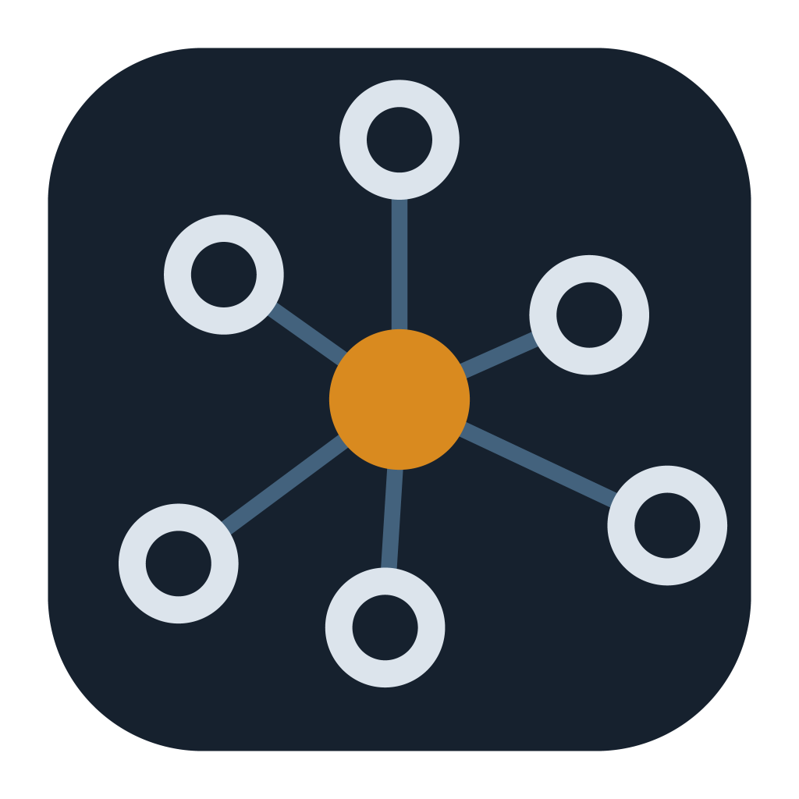

# Network Map

A desktop app that maps your home network, explains what it finds, and tells you
when something changes.

Built with [Wails](https://wails.io) — Go backend, React frontend. Windows only
for now; the discovery layer is portable, the capture layer is not.



---

## Why another network scanner

There are plenty of good ones. Fing, Advanced IP Scanner and your router's own
client list all list devices, and Fing's crowd-sourced device database beats
anything a solo project can build.

This one is aimed at the part they leave out: **telling you what any of it
means**. A list of open ports is data. "PostgreSQL is reachable from your entire
network, and that is almost certainly not what you intended" is an answer.

That principle runs through the whole app, including the parts where the honest
answer is *we don't know*.

## What it does

| View | What you get |
|---|---|
| **Map** | Live force-directed graph of every device, drawn as it is discovered |
| **Devices** | The same set as a table: IP, MAC, vendor, name, open ports |
| **Ports** | What is listening on *your own* machine, which program owns it, what that service is for, and whether it is reachable from the network |
| **Traffic** | A DNS forwarder: point your router at it and see which domains every device looks up |
| **Watch** | Record what is normal, then get told only what deviates |

### Device discovery

Devices are found through ICMP (via `IcmpSendEcho`, so no admin rights needed),
the Windows ARP cache, and a TCP connect scan. Names are resolved from six
independent sources, each kept with its provenance so you can see where a name
came from:

- **mDNS** — Apple devices, printers, Chromecast, smart home gear
- **NetBIOS** — Windows machines
- **SSDP/UPnP** — TVs, routers, NAS boxes
- **reverse DNS** — whatever your router happens to know
- **HTTP** — known local APIs (HomeWizard, Shelly, Hue, Tasmota, Plex) plus page titles
- **TLS certificates** — model identifiers for devices that advertise nothing else

Vendors come from the IEEE registry, queried in three tiers (MA-S → MA-M → MA-L).
Without that tiering, devices in shared blocks resolve to "IEEE Registration
Authority", which tells you nothing.

Names you assign yourself are stored against the MAC address, so they survive a
new IP and an app restart.

## What it deliberately does not do

This matters more than the feature list.

**It does not fabricate.** A rotating privacy MAC has no manufacturer, so none is
shown. A TLS certificate gives a *model*, not a name — three identical access
points share one, so it is labelled as a model and shown in parentheses. Ports it
cannot identify are marked unrecognised rather than guessed at.

**It does not draw switches.** An unmanaged switch has no IP, modifies no frames
and appears in no protocol. There is no way to see one, so none is drawn. Every
host hangs off the gateway, and the map says so.

**It does not ARP-spoof.** Seeing traffic between two other devices on a switched
network requires either port mirroring or man-in-the-middle. The second is not
built here — and detecting it is a feature instead.

**It does not claim to watch your whole network.** On a switched network this
machine sees its own traffic plus broadcast and multicast. The DNS forwarder is
the one route to other devices that needs no extra hardware. Anything beyond that
needs a managed switch with a mirror port.

**The Watch view does not say "danger".** A new device is usually a visitor's
phone; a new port is usually something you started yourself. It reports what
differs from yesterday and leaves the judgement to you. A tool that cries wolf at
every guest teaches you to ignore it.

## Requirements

- Go 1.25+
- Node 18+
- [Wails CLI](https://wails.io/docs/gettingstarted/installation) v2
- Windows 10 or later

Nothing else. No Npcap, no SDK, no cgo — the discovery and DNS layers are pure
Go. Packet capture uses a Windows raw socket, which needs administrator rights
but still no driver install.

## Build

```bash
wails build          # produces build/bin/netwerksniffer.exe
wails dev            # live reload during development
```

## Command line tools

Everything the app does is also available without a GUI.

```bash
go build -o scan.exe ./cmd/scan
scan.exe                            # quick scan, 20 ports per host
scan.exe -ports thorough            # 1–1024 plus well-known high ports
scan.exe -ports 22,80,8000-8100     # your own range
scan.exe -no-ports                  # discovery only (~3s for a /24)
scan.exe -list                      # show adapters

go build -o ports.exe ./cmd/ports
ports.exe -wide                     # local listeners, with explanations
ports.exe -connections              # outbound connections per process

go build -o dnslog.exe ./cmd/dnslog
dnslog.exe                          # DNS forwarder, live log

go build -o capture.exe ./cmd/opname
capture.exe -duration 60s           # writes a .pcap for Wireshark
capture.exe -snaplen 128            # headers only, small file

go build -o pcapinfo.exe ./cmd/pcapinfo
pcapinfo.exe capture.pcap           # summarise a capture without Wireshark
```

Three smaller diagnostics live in `cmd/` as well: `rawtest` (does this machine
deliver broadcast over raw sockets?), `protoprobe` (which discovery protocols
does a given device answer?) and `makeicon` (regenerates the app icon).

## Privacy

The app sends nothing anywhere. All findings stay in
`%AppData%\netwerksniffer\`: your assigned device names, the chosen language and
the baseline.

The DNS forwarder is the one component that handles other people's data — every
lookup from every device on your network passes through it. It forwards queries
verbatim to public resolvers (1.1.1.1 and 8.8.8.8 by default) and parses them
only for the log. A bug in the parser can never break your internet.

Note that running it makes your whole network depend on this machine for DNS. For
a few days of investigation that is fine; permanently, it belongs on something
that is always on.

## A note on antivirus

Packet capture puts the network card into promiscuous mode from an unsigned,
freshly compiled binary. That is the textbook signature heuristic scanners look
for, and they are not wrong to flag it — Wireshark maintains
[a page about the same problem](https://wiki.wireshark.org/FalsePositives).

Wireshark avoids most of it by delegating to Npcap, a signed kernel driver with a
decade of reputation. This project uses raw sockets instead, which needs no
install but has no reputation either. If your scanner objects, that is why. The
discovery, ports and DNS views do nothing unusual and are unaffected.

## Data sources

Vendor lookups use the public IEEE registry (`oui.csv`, `mam.csv`, `oui36.csv`),
compiled into a single compressed file embedded in the binary. Roughly 54,000
entries, 536 KB.

## Internationalisation

English and Dutch. The catalogue in `internal/i18n/locales/` is the single source
of truth: Go embeds it, and the frontend fetches it through a binding rather than
keeping its own copy. Adding a language is one JSON file — no code changes.

Log entries carry a message key and arguments rather than a finished sentence, so
switching language re-renders history too instead of leaving it in the old one.
Tests enforce that every language has identical keys and matching placeholders.

A build step generates a TypeScript union type from the catalogue, so a
misspelled key is a compile error rather than a blank button.

**Code comments are in Dutch.** The UI, the README and the public API are
English. Pull requests to translate the comments are welcome.

## Status

Built as a personal project and shared because the explanation layer turned out
to be the interesting part. It is not a product, there is no release pipeline,
and it has been tested on exactly one network. Issues and pull requests welcome.

## Licence

MIT — see [LICENSE](LICENSE).
